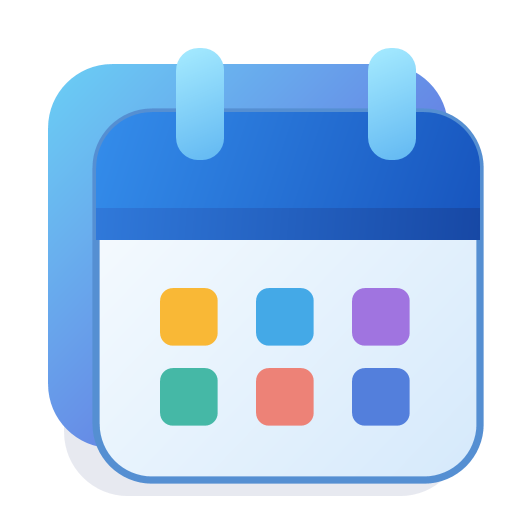

# Windows Calendar e Weather Widget

Widget WPF/Fluent para Windows 11 com previsão do tempo, calendários de leitura, bandeja, temas, transparência e inicialização com o Windows.

[Página do aplicativo](https://www.showmetech.com.br/windows-calendar-weather-widget/) · [Política de privacidade](https://www.showmetech.com.br/windows-calendar-weather-widget-privacidade/)



## Compatibilidade

- Windows 11 22000 ou posterior, x64 ou ARM64. Runtime .NET incluído nos builds de distribuição.
- Internet para clima e sincronização. Localização do Windows ou cidade manual.
- Google Calendar exige cliente OAuth válido e consentimento de cada usuário. Outlook/iCloud/outros podem ser adicionados por assinatura ICS ou arquivo local; não há OAuth Microsoft/Apple.
- Testes locais x64 e execução dos testes do binário ARM64 em Windows ARM64 nativo no GitHub Actions, sem promessa de compatibilidade com todo hardware. O CI também valida empacotamento MSIX com identidade exclusiva de teste, sem instalar ou certificar o pacote.

## Compilar

Instale .NET SDK 10 e Python 3.12 ou posterior. Em Windows:

```console
python scripts/release.py build
```

Os artefatos e hashes ficam em artifacts/. Os testes usam um perfil isolado e respostas de clima de teste. Nenhuma conta pessoal é incluída.

## Publicar e atualizar

Use o [fluxo de publicação](docs/PUBLISHING.md). Tags de versão acionam build, testes, GitHub Release e submissão à Microsoft Store. A certificação da Microsoft e a disponibilidade pública são etapas separadas. O primeiro cadastro/listagem e a configuração do Partner Center ainda precisam ser concluídos antes da publicação na Store.

## Dados e suporte

[Privacidade](PRIVACY.md). Contas e dados locais pertencem ao perfil do usuário. Nunca envie credenciais ou dados pessoais em issues. O código é disponibilizado para consulta; nenhuma licença adicional de redistribuição foi concedida nesta preparação. Licenças de terceiros estão em src/Assets/.
