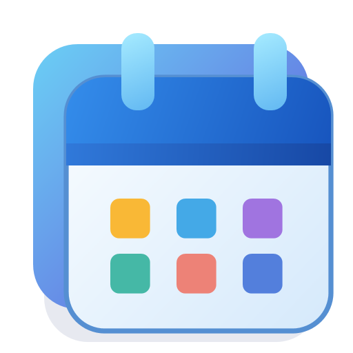

# SMT Calendar Widget

Widget WPF com linguagem visual Fluent para Windows 11: previsão do tempo, calendários em modo de leitura, bandeja e inicialização com o Windows.

[Microsoft Store](https://apps.microsoft.com/detail/9P32G6Q7BTSN) · [Releases](https://github.com/showmetech/windows-calendar-weather-widget/releases) · [Página do aplicativo](https://www.showmetech.com.br/windows-calendar-weather-widget/) · [Privacidade](https://www.showmetech.com.br/windows-calendar-weather-widget-privacidade/)



## Instalar e atualizar

Para uso normal, instale pela Microsoft Store. Atualize pela Biblioteca da Store, preservando a mesma identidade do aplicativo e os dados do seu perfil. Se o Windows informar que não há atualização, uma release do GitHub pode ainda estar em certificação; publicar no GitHub não libera automaticamente o pacote na Store.

A release 1.9.0 foi publicada no GitHub e enviada à certificação da Microsoft em 27/11/2026. Essa data não comprova que a atualização já está disponível na Store. O pacote de submissão MSIX sem assinatura de desenvolvimento não deve ser instalado manualmente. Não instale certificados de teste nem crie uma segunda instalação para contornar a certificação.

Os ZIPs x64 e ARM64 são artefatos independentes para uso técnico. Eles não substituem automaticamente uma instalação da Store e não devem ser executados simultaneamente com ela.

## Compatibilidade

- Windows 11 build 22000 ou posterior, x64 ou ARM64. O runtime .NET acompanha os builds de distribuição.
- Windows 10 e Windows de 32 bits não fazem parte da matriz de suporte.
- Internet é necessária para atualizar clima e calendários remotos. Sem rede, o app conserva a última leitura disponível.
- Localização automática depende da permissão do Windows e do serviço disponível no computador; a escolha manual de cidade é uma alternativa.
- O sistema e suas políticas controlam a inicialização e as atualizações automáticas. Configurações corporativas podem restringi-las.
- Cada perfil Windows mantém suas próprias preferências e autorizações. Não copie tokens, arquivos de conta ou sessões entre usuários ou computadores.

## Primeira configuração

Abra Configurações e escolha **Widget**, **Clima** ou **Agenda**. Tema do sistema, opacidade de 100%, localização automática e atualização a cada cinco minutos são os padrões iniciais. O Windows pode exigir que você confirme a inicialização automática ou a permissão de localização.

Na versão 1.9.0, **Conectar conta Google** usa o cliente Desktop dedicado do produto e inicia o consentimento no navegador. Não é necessário fornecer um JSON OAuth. Cada usuário escolhe e autoriza a própria conta; o app só lê calendários e eventos. A verificação pública da marca e dos escopos Google ainda está pendente, portanto a conexão pública para todas as contas não está declarada como concluída.

Se houver cancelamento, bloqueio de política ou erro de autorização, a mensagem no aplicativo indica a etapa. Não desative proteções nem compartilhe credenciais para contornar o erro. Assinaturas iCalendar (ICS) por URL HTTPS ou arquivo local são uma opção para serviços compatíveis; não há OAuth Microsoft ou Apple.

## Validação

A release 1.9.0 passou nos testes isolados x64 e na execução do binário ARM64 em runner Windows ARM64 nativo, além da validação de empacotamento MSIX. Layouts compactos, temas, teclado, contraste, intervalos e cenários de erro são cobertos por regressões.

Esses testes não comprovam instalação em todo hardware, primeiro consentimento de todas as contas, aprovação da Store ou funcionamento sob qualquer política corporativa. A inspeção nativa, testes internos, conexão real e instalação efetiva são verificações distintas.

## Compilar e distribuir

Instale .NET SDK 10 e Python 3.12 ou posterior. Em Windows:

```console
python scripts/release.py build
```

Os artefatos e hashes ficam em artifacts/. Os testes usam um perfil isolado e respostas de clima de teste. Nenhuma conta pessoal acompanha a distribuição.

Siga o [fluxo de publicação](docs/PUBLISHING.md). O build e a release são automáticos; a submissão Store depende das credenciais de publicação configuradas ou da rota manual autorizada no Partner Center. A certificação e a disponibilidade pública sempre precisam ser conferidas separadamente.

## Dados e suporte

[Privacidade](PRIVACY.md). Não envie senhas, tokens, URLs privadas de calendários ou eventos pessoais em issues. Informe versão, Windows/arquitetura, passos e mensagem de erro sem dados sensíveis. O código é disponibilizado para consulta; nenhuma licença adicional de redistribuição foi concedida nesta preparação. Licenças de terceiros estão em src/Assets/.
